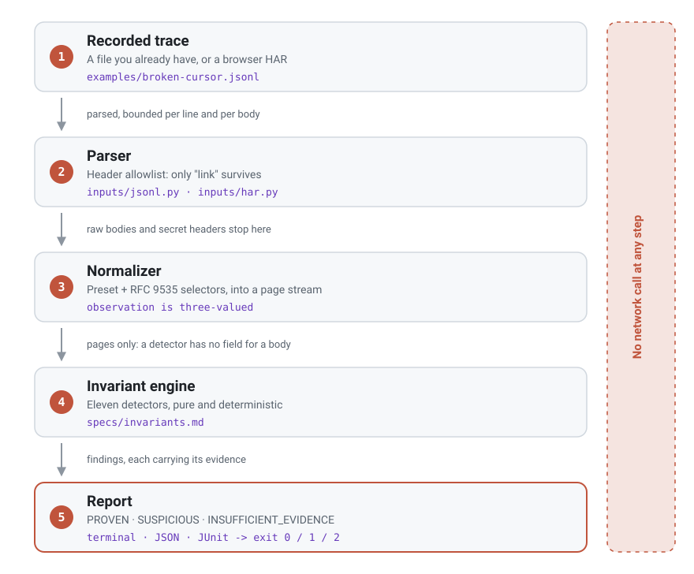

<div align="center">


**English** · [Русский](README.ru.md) · [中文](README.zh.md)

**Prove what your API pagination actually did. Offline, from a trace you already have.**

[](https://github.com/Corner324/PageTrace/actions/workflows/ci.yml)
[](docs/testing.md)
[](docs/testing.md)
[](docs/security.md)
[](docs/compatibility.md)
[](LICENSE)

[⚡ Install](#-install) · [🔍 How it works](#-how-it-works) · [🎯 Presets](#-presets) · [🧭 What it will not tell you](#-what-it-will-not-tell-you) · [🔒 Security](#-security) · [📐 Invariants](specs/invariants.md)

</div>

---

## 💡 Why this exists

Pagination fails quietly. Every page returns `200 OK`, the loop terminates, nothing is logged as
an error, and the export is short by four hundred rows. Nobody notices until someone reconciles
a total a month later, and by then the capture is gone.

The usual tools are the wrong shape for it. An integration test hits the live API and goes flaky.
Logs show you individual requests, never the relationship between them - and the bug always lives
in the relationship: page 3 asked for a token page 2 never handed out. Reading a HAR by hand works
right up to the twelfth page.

PageTrace takes the recording you already have and reports what it proves.

| You have heard | PageTrace answers, from the trace alone |
| -------------- | -------------------------------------- |
| "The export is missing rows" | whether a page was requested with a token the previous page never returned, whether the sequence revisited a state, whether the capture just stopped early |
| "The job runs forever" | whether the cursor stalled on one value, or the request sequence returned to a state it had already visited |
| "We get duplicates downstream" | which item identity appeared on which two pages |
| "Their API is broken" | which side the trace can actually attribute it to, which is often neither |

> [!IMPORTANT]
> **The one rule: never claim more than the trace proves.**
> Every finding carries a certainty and the exact observations behind it. There are no confidence
> scores anywhere in this tool. When the evidence is not there, it says
> `INSUFFICIENT_EVIDENCE` and names the flag you need to set, instead of guessing.

Three places it earns its keep: pinned to a regression test in CI, where a proven defect fails the
build; in your hand during an incident, where a colleague's HAR is the only evidence left; and
pointed at a vendor before you integrate, where you need the claim to survive being quoted back
at you.

---

## ⚡ See it in 30 seconds

```bash
uv run pagetrace check examples/broken-cursor.jsonl
```

```
broken-cursor.jsonl: 3 pages, preset cursor

PROVEN ERROR CURSOR_CONTINUATION_MISMATCH [INV-CURSOR-001] pages 1, 2
  Page 2 was requested with a continuation token that page 1 did not return.
  page[1].response.next_cursor = "eyJvIjo0fQ"
  page[2].request.cursor = "eyJvIjozfQ"

PROVEN WARNING DUPLICATE_ITEM_ACROSS_PAGES [INV-ITEM-001] pages 1, 2
  An item observed on page 1 was observed again on page 2; its identity is in the evidence below. That the same item appears twice is a fact; whether it means overlapping pages depends on a uniqueness contract this trace does not contain.
  page[1].items[0].id = 3
  page[2].items[0].id = 3

2 proven, 0 suspicious, 0 insufficient evidence
```

Exit code 1. Note what the second finding refuses to do: it reports the duplicate as a fact and
declines to call it a pagination bug, because no trace can carry a uniqueness contract. That is
the whole design in one message.

`examples/clean-cursor.jsonl` is the same run without the defects, and exits 0.

---

## 🔍 How it works

<div align="center">
<picture>
  <source media="(prefers-color-scheme: dark)" srcset="docs/assets/flow.en.dark.svg">
  
</picture>
</div>

The important part is structural, not a promise. A detector receives normalized observations and
nothing else: `Page` has no field for a raw body or an `authorization` header, so the engine
physically cannot read one. See [docs/architecture.md](docs/architecture.md).

---

## ⚡ Install

> [!NOTE]
> Installing from PyPI is not available yet. The release workflow publishes through Trusted
> Publishing over OIDC with no token fallback, so nothing can be published until a trusted
> publisher is configured for the project and the `pypi` environment
> ([docs/compatibility.md](docs/compatibility.md)).

From a clone, with [uv](https://docs.astral.sh/uv/):

```bash
uv sync
uv run pagetrace check examples/broken-cursor.jsonl
```

With pip into an environment of your own, or `pipx install .` for a standalone command:

```bash
pip install .
```

---

## 📼 Record a trace

A JSONL trace is one JSON object per line, one per request/response pair, in capture order:

```json
{"v": 1, "seq": 0, "request": {"method": "GET", "url": "https://api.example.com/v1/items?limit=2"}, "response": {"status": 200, "headers": {"content-type": "application/json"}, "body": {"items": [{"id": 1, "name": "item-1"}, {"id": 2, "name": "item-2"}], "next_cursor": "eyJvIjoyfQ", "has_more": true, "total": 5}}}
```

`v` and `response.status` are required; `seq` is optional and line order is authoritative. Full
rules: [specs/formats/jsonl-v1.md](specs/formats/jsonl-v1.md).

<details>
<summary><b>Or export a HAR from the browser</b> - no code to write, works against anyone's API</summary>

<br>

Open DevTools, go to the Network tab, reproduce the pagination, export the request list as HAR.
A browser capture holds every asset the page loaded, so filter it down to the API calls:

```bash
uv run pagetrace check your-capture.har --url-filter /v1/items
```

`OPTIONS` and `HEAD` requests are dropped before pages are numbered, so a CORS preflight never
looks like a client that failed to advance.

</details>

> [!WARNING]
> A HAR holds live credentials. PageTrace keeps exactly one response header and never renders a
> body, but the file on your disk still contains your `Authorization` header - treat it like a
> password, and do not attach it to a public issue.

---

## 🎯 Presets

Selectors are [RFC 9535](https://www.rfc-editor.org/rfc/rfc9535.html) JSONPath. A preset default
that does not match resolves to "not found" and proves nothing, rather than becoming a guess.

| Preset | Default selectors | Fits |
| ------ | ----------------- | ---- |
| `cursor` <sub>default</sub> | `--cursor $.query.cursor` `--next $.next_cursor` `--items $.items` `--id $.id` `--total $.total` `--has-more $.has_more` | APIs that hand back an opaque continuation token |
| `page` | `--page $.query.page`, plus the same items / id / total / has-more defaults | page numbers, 0-based or 1-based |
| `offset` | `--offset $.query.offset`, plus the same items / id / total / has-more defaults | an offset and a limit |
| `link` | items / id / total / has-more only; continuation comes from the HTTP `Link` header | `rel="next"` in a Link header (RFC 8288) |

> [!TIP]
> Every default is overridable by flag, and `uv run pagetrace check --help` prints all of them
> with the preset each belongs to. If a finding says `INSUFFICIENT_EVIDENCE`, the flag to set is
> named in the message.

---

## 📊 Certainty, severity, exit codes

Two independent axes. Certainty is what the evidence supports; severity is how much it matters if
true. A finding is never a probability.

| Certainty | Meaning |
| --------- | ------- |
| `PROVEN` | the trace itself shows it, with the preconditions satisfied |
| `SUSPICIOUS` | consistent with a defect **and** with an innocent explanation |
| `INSUFFICIENT_EVIDENCE` | the selector or the trace did not supply what the check needs |

| Exit | Meaning |
| ---- | ------- |
| `0` | nothing both proven and severe |
| `1` | at least one `PROVEN` finding of severity `ERROR` |
| `2` | invalid input or configuration |

Exit 1 needs both axes. A duplicate item across pages is `PROVEN WARNING` and does not fail a
build: the finding declines to say whether overlapping windows are a bug, so failing on it would
be the tool claiming what its own message refuses to. A build that goes red on "this might be a
cache" trains people to ignore the tool.

For CI, take the machine formats rather than the terminal text, which is not a contract:

```bash
uv run pagetrace check examples/broken-cursor.jsonl --format json --output report.json
```

---

## 🧭 What it will not tell you

This section is the point of the project, not a disclaimer.

- **That pagination never terminates.** A finite trace can prove the sequence revisited a state,
  and that is what `INV-CURSOR-003` says. A cycle back to the page-0 state after a `null` cursor
  drops to `SUSPICIOUS`, because two concatenated runs look exactly the same.
- **That records are missing.** `INV-TOTAL-001` compares a declared total against observed
  identities and is never worded as "N records are missing": PageTrace does not know that `total`
  counts the same population, that the dataset held still, or that the same filters applied.
- **That the API is at fault.** `INV-CONT-001` and `INV-TRACE-001` report that the trace ended
  while the server was still offering more, and name neither the API, the client, nor the recorder.
- **Anything about a duplicate beyond the duplicate itself**, without a uniqueness contract the
  trace does not contain.
- **Anything from a page it could not read.** Non-2xx responses are excluded from every
  body-derived check and reported once by `INV-TRACE-002`, so a trace nobody could read never
  looks clean.
- **Anything a selector did not resolve.** Matching nothing, matching twice, or landing on an
  object is `INSUFFICIENT_EVIDENCE` naming the flag, never a guess. JSON `null` is a different
  state: an observation meaning "the server declared no continuation".
- **That `5` and `"5"` differ** - comparison is on the canonical text form, because a query
  parameter can only carry text - or that a truthy `1` or `"true"` means `has_more`. Only a
  boolean counts.

Every claim and every non-claim condition is in [specs/invariants.md](specs/invariants.md), the
normative contract for the tool. Eleven invariants, each with written preconditions.

---

## 🔒 Security

A HAR or JSONL trace is an untrusted, secret-bearing file. Parsers keep exactly one response
header, `link`, because exactly one is read; `authorization`, `cookie` and everything else is
dropped before the model is built. Raw bodies never reach a detector or a renderer, so only the
scalars you selected are displayed, with control characters escaped and lengths truncated. Input
is bounded per line and per decoded body, exceeding a limit is a usage error rather than a
traceback, and the package contains no networking dependency or code path at all. Threat table
and limits: [docs/security.md](docs/security.md).

---

## 📈 Performance

Measured 2026-09-11, one run per shape on a Windows 11 developer machine with CPython 3.12.6;
memory is peak Python allocation from `tracemalloc`. The shape of the numbers is the finding, not
the third digit.

| Shape | Pages | Items | Seconds | Peak MiB |
| ----- | ----: | ----: | ------: | -------: |
| wide | 1 000 | 100 000 | 2.6 | 16.1 |
| very wide | 1 000 | 1 000 000 | 20.9 | 156.8 |
| ten thousand pages | 10 000 | 1 000 000 | 28.3 | 142.8 |
| hundred thousand pages | 100 000 | 5 000 000 | 120.8 | 715.4 |

> [!NOTE]
> Three time targets are missed and stay written down as targets rather than quietly relaxed:
> 1k pages / 100k ids wants 2 s and takes 2.6 s; 10k / 1M wants 10 s and takes 28.3 s, about 3x
> over; the 100k / 5M stretch target wants 60 s and takes 120.8 s, about 2x over. Both memory
> targets are met with room to spare. Full table and reasoning:
> [docs/performance.md](docs/performance.md).

---

## 🛠 Contributing

```bash
uv run ruff check . && uv run ruff format --check . && uv run pyright && uv run pytest
```

425 tests pass locally at 98.97% branch coverage, on 3.11, 3.12, 3.13 and 3.14 on Windows. The
property suite in `tests/property/` is the main correctness layer: a valid generated trace must
produce no `PROVEN` finding, and each mutation operator must wake exactly one detector. Mutation
score is 77.9% against the unit tests as of 2026-09-12, with the survivors sorted by hand in
[docs/testing.md](docs/testing.md); mutmut refuses to run on Windows, so that run came from a
Linux container.

Before a new detector: an entry in [specs/invariants.md](specs/invariants.md) with its non-claim
conditions, then the test oracle, then the code. [CONTRIBUTING.md](CONTRIBUTING.md) has the
workflow and the definition of done, [AGENTS.md](AGENTS.md) the same for coding agents, and the
rest is in [docs/architecture.md](docs/architecture.md), [docs/testing.md](docs/testing.md),
[docs/compatibility.md](docs/compatibility.md), [docs/adr/](docs/adr/) and
[CHANGELOG.md](CHANGELOG.md).

<div align="center">

**MIT** · [LICENSE](LICENSE)

</div>
