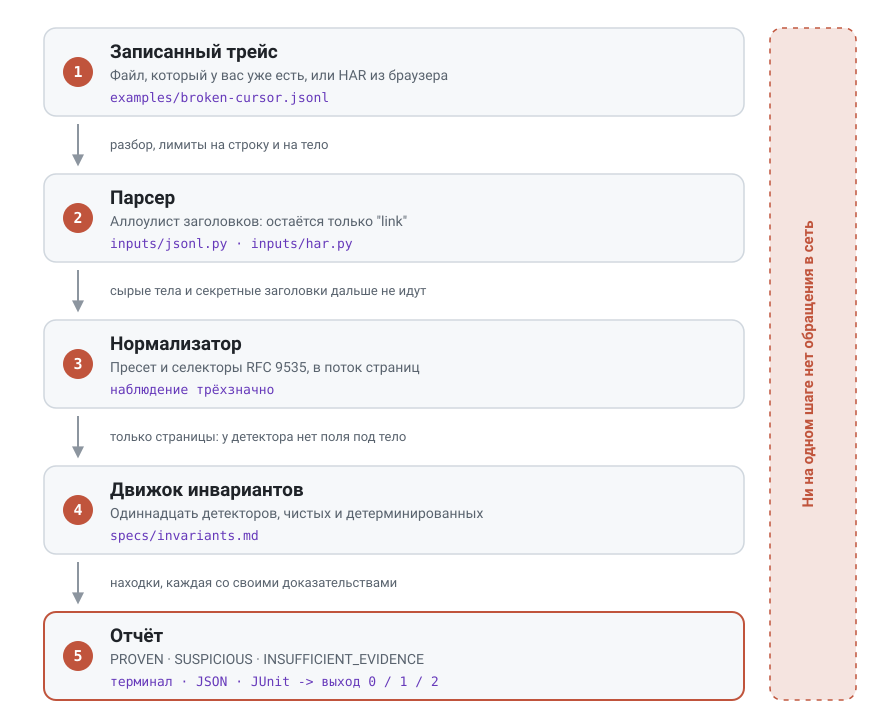

<div align="center">


[English](README.md) · **Русский** · [中文](README.zh.md)

**Докажите, что на самом деле сделала пагинация вашего API. Офлайн, по записи, которая у вас уже есть.**

[](https://github.com/Corner324/PageTrace/actions/workflows/ci.yml)
[](https://pypi.org/project/pagetrace/)
[](docs/testing.md)
[](docs/testing.md)
[](docs/security.md)
[](docs/compatibility.md)
[](LICENSE)

[⚡ Установка](#-установка) · [🔍 Как это работает](#-как-это-работает) · [🎯 Пресеты](#-пресеты) · [🧭 Чего он не скажет](#-чего-он-вам-не-скажет) · [🔒 Безопасность](#-безопасность) · [📐 Инварианты](specs/invariants.md)

</div>

---

## 💡 Зачем это нужно

Пагинация ломается тихо. Каждая страница возвращает `200 OK`, цикл нормально завершается, в логах
ни одной ошибки, а в выгрузке не хватает четырёхсот строк. Замечают это, когда через месяц кто-то
сверяет итоги, и запись обмена к тому моменту давно стёрта.

Обычные инструменты тут не той формы. Интеграционный тест ходит в живой API и начинает флакать.
Логи показывают отдельные запросы, но никогда - связь между ними, а баг живёт именно в связи:
страница 3 попросила токен, которого страница 2 не выдавала. Читать HAR глазами работает ровно
до двенадцатой страницы.

PageTrace берёт запись, которая у вас уже есть, и говорит, что она доказывает.

| Что вам сказали | Что PageTrace ответит по одному трейсу |
| --------------- | -------------------------------------- |
| "В выгрузке не хватает строк" | запрашивалась ли страница с токеном, которого предыдущая не отдавала; возвращалась ли последовательность в уже посещённое состояние; не оборвалась ли запись раньше времени |
| "Задача крутится вечно" | застрял ли курсор на одном значении или последовательность запросов вернулась туда, где уже была |
| "Вниз по потоку приходят дубли" | какая именно идентичность элемента встретилась на каких двух страницах |
| "У них API сломан" | на какую сторону трейс вообще позволяет это отнести, а чаще всего ни на какую |

> [!IMPORTANT]
> **Единственное правило: никогда не утверждать больше, чем доказывает трейс.**
> Каждая находка несёт свою уверенность и точные наблюдения, на которых стоит. Числовых оценок
> уверенности нет нигде. Когда данных не хватает, инструмент говорит `INSUFFICIENT_EVIDENCE` и
> называет флаг, который нужно выставить, вместо того чтобы гадать.

Три места, где он окупается: приколоченным к регрессионному тесту в CI, где доказанный дефект
роняет сборку; в руках во время инцидента, когда HAR от коллеги - единственное оставшееся
свидетельство; и наведённым на чужой API перед интеграцией, когда утверждение должно пережить
то, что его процитируют вам в ответ.

---

## ⚡ Посмотреть за 30 секунд

```bash
uv run pagetrace check examples/broken-cursor.jsonl
```

```
broken-cursor.jsonl: 3 pages, preset cursor

PROVEN ERROR CURSOR_CONTINUATION_MISMATCH [INV-CURSOR-001] pages 1, 2
  Page 2 was requested with a continuation token that page 1 did not return.
  page[1].response.next_cursor = "eyJvIjo0fQ"
  page[2].request.cursor = "eyJvIjozfQ"

PROVEN WARNING DUPLICATE_ITEM_ACROSS_PAGES [INV-ITEM-001] pages 1, 2
  An item observed on page 1 was observed again on page 2; its identity is in the evidence below. That the same item appears twice is a fact; whether it means overlapping pages depends on a uniqueness contract this trace does not contain.
  page[1].items[0].id = 3
  page[2].items[0].id = 3

2 proven, 0 suspicious, 0 insufficient evidence
```

Код выхода 1. Обратите внимание, чего вторая находка делать отказывается: она сообщает дубликат
как факт и не называет его багом пагинации, потому что ни один трейс не содержит контракта
уникальности. Это весь замысел проекта в одном сообщении.

`examples/clean-cursor.jsonl` - тот же прогон без дефектов, выходит с 0.

---

## 🔍 Как это работает

<div align="center">
<picture>
  <source media="(prefers-color-scheme: dark)" srcset="docs/assets/flow.ru.dark.svg">
  
</picture>
</div>

Главное здесь - устройство, а не обещание. Детектор получает нормализованные наблюдения и больше
ничего: у `Page` нет поля ни под сырое тело, ни под заголовок `authorization`, поэтому движок
физически не способен их прочитать. Подробности: [docs/architecture.md](docs/architecture.md).

---

## ⚡ Установка

```bash
pip install pagetrace
```

Для отдельной команды то же самое делают `pipx install pagetrace` или `uv tool install pagetrace`.

Чтобы запустить примеры из репозитория, склонируйте его и используйте [uv](https://docs.astral.sh/uv/):

```bash
uv sync
uv run pagetrace check examples/broken-cursor.jsonl
```

---

## 📼 Как записать трейс

Трейс JSONL - это по одному JSON-объекту на строку, по объекту на пару запрос-ответ, в порядке
записи:

```json
{"v": 1, "seq": 0, "request": {"method": "GET", "url": "https://api.example.com/v1/items?limit=2"}, "response": {"status": 200, "headers": {"content-type": "application/json"}, "body": {"items": [{"id": 1, "name": "item-1"}, {"id": 2, "name": "item-2"}], "next_cursor": "eyJvIjoyfQ", "has_more": true, "total": 5}}}
```

`v` и `response.status` обязательны, `seq` необязателен, порядок строк главнее. Полные правила:
[specs/formats/jsonl-v1.md](specs/formats/jsonl-v1.md).

<details>
<summary><b>Или выгрузите HAR из браузера</b> - кода писать не надо, работает с любым чужим API</summary>

<br>

Откройте DevTools, вкладку Network, воспроизведите пагинацию, выгрузите список запросов как HAR.
Браузерная запись содержит все ресурсы, которые загрузила страница, поэтому отфильтруйте её до
вызовов API:

```bash
uv run pagetrace check your-capture.har --url-filter /v1/items
```

Запросы `OPTIONS` и `HEAD` выбрасываются до нумерации страниц, поэтому CORS-предзапрос никогда не
выглядит как клиент, не сумевший продвинуться.

</details>

> [!WARNING]
> HAR содержит живые учётные данные. PageTrace оставляет ровно один заголовок ответа и никогда не
> печатает тела, но файл у вас на диске всё равно хранит ваш `Authorization` - обращайтесь с ним
> как с паролем и не прикладывайте к публичной issue.

---

## 🎯 Пресеты

Селекторы - это JSONPath по [RFC 9535](https://www.rfc-editor.org/rfc/rfc9535.html). Дефолт
пресета, который ни на что не попал, разрешается в "не найдено" и ничего не доказывает, вместо
того чтобы стать догадкой.

| Пресет | Селекторы по умолчанию | Подходит |
| ------ | ---------------------- | -------- |
| `cursor` <sub>по умолчанию</sub> | `--cursor $.query.cursor` `--next $.next_cursor` `--items $.items` `--id $.id` `--total $.total` `--has-more $.has_more` | API, отдающим непрозрачный токен продолжения |
| `page` | `--page $.query.page`, плюс те же items / id / total / has-more | номера страниц, от нуля или от единицы |
| `offset` | `--offset $.query.offset`, плюс те же items / id / total / has-more | смещение и лимит |
| `link` | только items / id / total / has-more, продолжение из HTTP-заголовка `Link` | `rel="next"` в заголовке Link (RFC 8288) |

> [!TIP]
> Любой дефолт переопределяется флагом, а `uv run pagetrace check --help` печатает их все с
> указанием пресета. Если находка говорит `INSUFFICIENT_EVIDENCE`, нужный флаг назван прямо в
> сообщении.

---

## 📊 Уверенность, серьёзность, коды выхода

Две независимые оси. Уверенность - что подтверждают данные; серьёзность - насколько это важно,
если верно. Находка никогда не является вероятностью.

| Уверенность | Значение |
| ----------- | -------- |
| `PROVEN` | сам трейс это показывает, предпосылки выполнены |
| `SUSPICIOUS` | согласуется **и** с дефектом, **и** с безобидным объяснением |
| `INSUFFICIENT_EVIDENCE` | селектор или трейс не дали того, что нужно проверке |

| Выход | Значение |
| ----- | -------- |
| `0` | ничего одновременно доказанного и серьёзного |
| `1` | есть хотя бы одна находка `PROVEN` с серьёзностью `ERROR` |
| `2` | некорректный вход или конфигурация |

Для выхода 1 нужны обе оси. Дубликат элемента между страницами - это `PROVEN WARNING`, и сборку он
не роняет: сама находка отказывается говорить, баг ли перекрытие окон, так что падение на ней было
бы утверждением того, от чего отказывается её же текст. Сборка, краснеющая на "возможно, это кэш",
приучает людей игнорировать инструмент.

Для CI берите машинные форматы, а не текст терминала:

```bash
uv run pagetrace check examples/broken-cursor.jsonl --format json --output report.json
```

---

## 🧭 Чего он вам не скажет

Этот раздел - смысл проекта, а не отписка мелким шрифтом.

- **Что пагинация никогда не завершится.** Конечный трейс может доказать, что последовательность
  вернулась в уже посещённое состояние, и ровно это говорит `INV-CURSOR-003`. Цикл в состояние
  страницы 0 после `null`-курсора понижается до `SUSPICIOUS`, потому что два склеенных прогона
  выглядят точно так же.
- **Что записи потеряны.** `INV-TOTAL-001` сравнивает объявленный тотал с наблюдёнными
  идентичностями и никогда не формулируется как "потеряно N записей": PageTrace не знает, что
  `total` считает ту же совокупность, что набор данных не менялся и что к обоим применялись одни
  фильтры.
- **Что виноват API.** `INV-CONT-001` и `INV-TRACE-001` сообщают, что трейс кончился, пока сервер
  ещё предлагал продолжение, и не называют виновным ни API, ни клиента, ни записывающего.
- **Ничего про дубликат сверх самого дубликата**, без контракта уникальности, которого в трейсе
  нет.
- **Ничего со страницы, которую не смог прочитать.** Ответы вне 2xx исключаются из всех проверок,
  читающих тело, и об исключении один раз сообщает `INV-TRACE-002`, так что трейс, который никто
  не смог прочесть, никогда не выглядит чистым.
- **Ничего про селектор, который не разрешился.** Ноль совпадений, два совпадения или попадание в
  объект - это `INSUFFICIENT_EVIDENCE` с указанием флага, а не догадка. JSON `null` - другое
  состояние: наблюдение со значением "сервер объявил, что продолжения нет".
- **Что `5` и `"5"` различаются** - сравнение идёт по канонической текстовой форме, потому что
  параметр запроса умеет нести только текст. И что `1` или `"true"` означают `has_more`:
  считается только булево значение.

Каждое утверждение и каждое условие молчания записаны в
[specs/invariants.md](specs/invariants.md), нормативном контракте инструмента. Одиннадцать
инвариантов, у каждого прописаны предпосылки.

---

## 🔒 Безопасность

Трейс HAR или JSONL - недоверенный файл, несущий секреты. Парсеры оставляют ровно один заголовок
ответа, `link`, потому что читается ровно один; `authorization`, `cookie` и всё остальное
выбрасывается до сборки модели. Сырые тела не доходят ни до детектора, ни до рендерера, поэтому
показываются только выбранные вами скаляры, с экранированием управляющих символов и обрезкой
длины. Вход ограничен по строке и по декодированному телу, превышение лимита - ошибка
использования, а не трейсбек, и в пакете вообще нет ни сетевой зависимости, ни сетевого кода.
Таблица угроз и лимиты: [docs/security.md](docs/security.md).

---

## 📈 Производительность

Замер 2026-09-11, по одному прогону на форму, на рабочей машине с Windows 11 и CPython 3.12.6;
память - пиковое выделение Python по `tracemalloc`. Находка здесь - форма чисел, а не третий знак.

| Форма | Страниц | Элементов | Секунд | Пик, MiB |
| ----- | ------: | --------: | -----: | -------: |
| широкая | 1 000 | 100 000 | 2.6 | 16.1 |
| очень широкая | 1 000 | 1 000 000 | 20.9 | 156.8 |
| десять тысяч страниц | 10 000 | 1 000 000 | 28.3 | 142.8 |
| сто тысяч страниц | 100 000 | 5 000 000 | 120.8 | 715.4 |

> [!NOTE]
> Три цели по времени не достигнуты и остаются записанными как цели, а не тихо ослаблены: 1k
> страниц / 100k id хотят 2 с, а занимают 2.6 с; 10k / 1M хотят 10 с, а занимают 28.3 с, примерно
> втрое больше; растянутая цель 100k / 5M хочет 60 с, а занимает 120.8 с, примерно вдвое больше.
> Обе цели по памяти выполнены с запасом. Полная таблица и разбор:
> [docs/performance.md](docs/performance.md).

---

## 🛠 Участие в разработке

```bash
uv run ruff check . && uv run ruff format --check . && uv run pyright && uv run pytest
```

425 тестов проходят локально при покрытии по ветвям 98.97%, на 3.11, 3.12, 3.13 и 3.14 под
Windows. Основной слой корректности - property-набор в `tests/property/`: сгенерированный валидный
трейс не должен давать ни одной находки `PROVEN`, и каждый мутационный оператор должен будить
ровно один детектор. Мутационный счёт - 77.9% против юнит-тестов на 2026-09-12, выжившие мутанты
разобраны руками в [docs/testing.md](docs/testing.md); mutmut отказывается работать под Windows,
так что тот прогон сделан в контейнере с Linux.

Перед новым детектором: запись в [specs/invariants.md](specs/invariants.md) с условиями молчания,
затем тестовый оракул, затем код. В [CONTRIBUTING.md](CONTRIBUTING.md) лежат процесс и определение
готовности, в [AGENTS.md](AGENTS.md) то же самое для кодовых агентов, остальное - в
[docs/architecture.md](docs/architecture.md), [docs/testing.md](docs/testing.md),
[docs/compatibility.md](docs/compatibility.md), [docs/adr/](docs/adr/) и
[CHANGELOG.md](CHANGELOG.md).

<div align="center">

**MIT** · [LICENSE](LICENSE)

</div>
