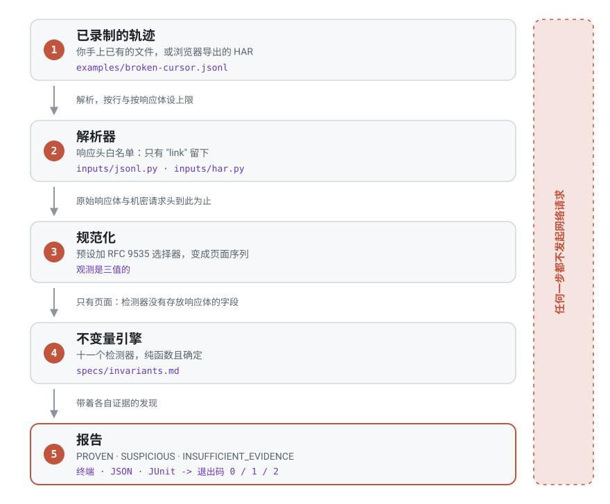

<div align="center">


[English](README.md) · [Русский](README.ru.md) · **中文**

**证明你的 API 分页到底做了什么。离线运行，只用你手上已有的那份录制。**

[](https://github.com/Corner324/PageTrace/actions/workflows/ci.yml)
[](docs/testing.md)
[](docs/testing.md)
[](docs/security.md)
[](docs/compatibility.md)
[](LICENSE)

[⚡ 安装](#-安装) · [🔍 工作原理](#-工作原理) · [🎯 预设](#-预设) · [🧭 它不会告诉你什么](#-它不会告诉你什么) · [🔒 安全](#-安全) · [📐 不变量](specs/invariants.md)

</div>

---

## 💡 为什么需要它

分页出错是悄无声息的。每一页都返回 `200 OK`，循环正常结束，日志里没有任何错误，而导出的数据
少了四百行。等到一个月后有人去对总数，才发现问题，那时候当初的录制早就没了。

常用的工具在这里形状不对。集成测试要打真实 API，很快就变得不稳定。日志能给你单个请求，却从不
给你请求之间的关系，而 bug 恰恰住在关系里：第 3 页拿着第 2 页从未发出过的令牌去请求。用眼睛读
HAR 这招，能撑到第十二页。

PageTrace 接过你手上已有的那份录制，告诉你它能证明什么。

| 你听到的说法 | PageTrace 仅凭一份轨迹就能回答 |
| ------------ | ------------------------------ |
| "导出的数据少了几行" | 某一页是否用了上一页从未返回过的令牌；请求序列是否回到了曾到过的状态；录制是不是干脆提前停了 |
| "任务一直跑不完" | 游标是否卡在同一个值上，或者请求序列是否回到了它去过的状态 |
| "下游收到了重复数据" | 究竟是哪个条目身份出现在了哪两页上 |
| "是他们的 API 坏了" | 这份轨迹究竟能把责任归到哪一边，而答案往往是哪一边都不能 |

> [!IMPORTANT]
> **唯一的规则：绝不宣称超出轨迹所能证明的东西。**
> 每条发现都带着自己的确定性，以及它所依据的确切观测。这个工具里任何地方都没有置信度分数。
> 当证据不足时，它会给出 `INSUFFICIENT_EVIDENCE` 并指明你需要设置哪个命令行标志，而不是去猜。

它在三个场合能挣回自己的位置：钉在 CI 的回归测试上，让已被证明的缺陷直接让构建失败；握在手里
处理线上事故，当同事导出的 HAR 是仅存的证据；以及在接入前对着供应商的 API 跑一遍，那时你的
结论必须经得起被原话引用回来。

---

## ⚡ 三十秒看明白

```bash
uv run pagetrace check examples/broken-cursor.jsonl
```

```
broken-cursor.jsonl: 3 pages, preset cursor

PROVEN ERROR CURSOR_CONTINUATION_MISMATCH [INV-CURSOR-001] pages 1, 2
  Page 2 was requested with a continuation token that page 1 did not return.
  page[1].response.next_cursor = "eyJvIjo0fQ"
  page[2].request.cursor = "eyJvIjozfQ"

PROVEN WARNING DUPLICATE_ITEM_ACROSS_PAGES [INV-ITEM-001] pages 1, 2
  An item observed on page 1 was observed again on page 2; its identity is in the evidence below. That the same item appears twice is a fact; whether it means overlapping pages depends on a uniqueness contract this trace does not contain.
  page[1].items[0].id = 3
  page[2].items[0].id = 3

2 proven, 0 suspicious, 0 insufficient evidence
```

退出码为 1。请注意第二条发现拒绝做什么：它把重复当作事实报告出来，却不称其为分页 bug，因为任何
轨迹都不可能携带唯一性契约。整个设计意图，就浓缩在这一条消息里。

`examples/clean-cursor.jsonl` 是同一次运行但没有缺陷，退出码为 0。

---

## 🔍 工作原理

<div align="center">
<picture>
  <source media="(prefers-color-scheme: dark)" srcset="docs/assets/flow.zh.dark.svg">
  
</picture>
</div>

这里关键的是结构，而不是一句承诺。检测器只拿到规范化后的观测，别的什么也拿不到：`Page` 既没有
存放原始响应体的字段，也没有存放 `authorization` 头的字段，所以引擎在物理上就读不到它们。
详见 [docs/architecture.md](docs/architecture.md)。

---

## ⚡ 安装

> [!NOTE]
> 暂时无法从 PyPI 安装。发布工作流通过 OIDC 上的 Trusted Publishing 发布，且刻意不保留 API
> token 兜底，因此在为该项目和 `pypi` 环境配置好受信任发布者之前，任何东西都发布不出去
> （见 [docs/compatibility.md](docs/compatibility.md)）。

从仓库克隆，使用 [uv](https://docs.astral.sh/uv/)：

```bash
uv sync
uv run pagetrace check examples/broken-cursor.jsonl
```

用 pip 装进你自己的环境，或者用 `pipx install .` 作为独立命令：

```bash
pip install .
```

---

## 📼 如何录制轨迹

JSONL 轨迹是每行一个 JSON 对象，每个对象对应一对请求／响应，按录制顺序排列：

```json
{"v": 1, "seq": 0, "request": {"method": "GET", "url": "https://api.example.com/v1/items?limit=2"}, "response": {"status": 200, "headers": {"content-type": "application/json"}, "body": {"items": [{"id": 1, "name": "item-1"}, {"id": 2, "name": "item-2"}], "next_cursor": "eyJvIjoyfQ", "has_more": true, "total": 5}}}
```

`v` 与 `response.status` 必填，`seq` 可选，行顺序具有权威性。完整规则见
[specs/formats/jsonl-v1.md](specs/formats/jsonl-v1.md)。

<details>
<summary><b>或者从浏览器导出 HAR</b> —— 不用写代码，对任何人的 API 都能用</summary>

<br>

打开 DevTools 的 Network 标签页，复现一次分页，把请求列表导出为 HAR。浏览器录制会包含页面加载的
所有资源，所以要先把它过滤到 API 调用：

```bash
uv run pagetrace check your-capture.har --url-filter /v1/items
```

`OPTIONS` 与 `HEAD` 请求在页面编号之前就被丢弃，因此 CORS 预检请求绝不会看起来像一个没能前进的
客户端。

</details>

> [!WARNING]
> HAR 里装着真实可用的凭据。PageTrace 只保留一个响应头、从不渲染响应体，但你磁盘上那个文件
> 仍然含有你的 `Authorization` —— 请把它当成密码对待，不要附到公开的 issue 里。

---

## 🎯 预设

选择器是 [RFC 9535](https://www.rfc-editor.org/rfc/rfc9535.html) 的 JSONPath。预设默认值若匹配
不到任何东西，就解析为"未找到"并且什么也不证明，而不是变成一个猜测。

| 预设 | 默认选择器 | 适用于 |
| ---- | ---------- | ------ |
| `cursor` <sub>默认</sub> | `--cursor $.query.cursor` `--next $.next_cursor` `--items $.items` `--id $.id` `--total $.total` `--has-more $.has_more` | 返回不透明续传令牌的 API |
| `page` | `--page $.query.page`，以及同样的 items / id / total / has-more | 页码，从 0 或从 1 开始 |
| `offset` | `--offset $.query.offset`，以及同样的 items / id / total / has-more | offset 与 limit |
| `link` | 只有 items / id / total / has-more，续传来自 HTTP `Link` 头 | Link 头中的 `rel="next"`（RFC 8288） |

> [!TIP]
> 每个默认值都可以用命令行标志覆盖，`uv run pagetrace check --help` 会把它们连同所属预设一起
> 打印出来。如果某条发现是 `INSUFFICIENT_EVIDENCE`，该设置哪个标志就写在消息里。

---

## 📊 确定性、严重度、退出码

两条独立的轴。确定性是证据支持什么；严重度是若其成立有多要紧。发现永远不是一个概率。

| 确定性 | 含义 |
| ------ | ---- |
| `PROVEN` | 轨迹本身显示了这一点，且前置条件成立 |
| `SUSPICIOUS` | 既符合缺陷，**也**符合某种无害的解释 |
| `INSUFFICIENT_EVIDENCE` | 选择器或轨迹没有提供这项检查所需的东西 |

| 退出码 | 含义 |
| ------ | ---- |
| `0` | 没有既被证明又足够严重的问题 |
| `1` | 至少有一条严重度为 `ERROR` 的 `PROVEN` 发现 |
| `2` | 输入或配置无效 |

退出码 1 需要两条轴同时满足。跨页重复条目是 `PROVEN WARNING`，不会让构建失败：这条发现本身
拒绝断言窗口重叠是不是 bug，若因它而失败，工具就等于宣称了自己在正文里拒绝宣称的东西。一个
因为"这也许只是缓存"而变红的构建，只会训练人们忽略这个工具。

在 CI 里请使用机器可读格式，而不是终端文本：

```bash
uv run pagetrace check examples/broken-cursor.jsonl --format json --output report.json
```

---

## 🧭 它不会告诉你什么

这一节是本项目的要点所在，不是一段免责声明。

- **分页永不终止。** 有限的轨迹能证明序列回到了曾经到过的状态，`INV-CURSOR-003` 说的正是这一点。
  若在 `null` 游标之后回到第 0 页的状态，则降级为 `SUSPICIOUS`，因为两段拼接起来的运行看上去
  一模一样。
- **有记录丢失。** `INV-TOTAL-001` 把声明的总数与观测到的条目身份作比较，措辞绝不会是"丢了 N
  条记录"：PageTrace 并不知道 `total` 统计的是同一个总体，不知道数据集在录制期间没有变动，也
  不知道两边应用了相同的过滤条件。
- **API 有错。** `INV-CONT-001` 与 `INV-TRACE-001` 报告的是轨迹在服务端仍提供后续内容时就结束了，
  既不指认 API，也不指认客户端或录制方。
- **关于重复条目、超出重复本身的任何结论**，除非有一份轨迹里并不包含的唯一性契约。
- **关于它读不了的那一页的任何结论。** 非 2xx 响应被排除在所有读取响应体的检查之外，并由
  `INV-TRACE-002` 统一报告一次，因此一份谁也读不了的轨迹绝不会看起来是干净的。
- **关于没有真正解析成功的选择器的任何结论。** 匹配不到、匹配到两个、或者落在一个对象上，都是
  `INSUFFICIENT_EVIDENCE` 并指明是哪个标志，而不是猜测。JSON `null` 是另一种状态：它是一次观测，
  含义是"服务端声明没有后续"。
- **`5` 与 `"5"` 有区别**：比较按规范化文本形式进行，因为查询参数只能承载文本。也不会认为 `1`
  或 `"true"` 表示 `has_more`：只有布尔值才算数。

每一条宣称和每一条保持沉默的条件都写在 [specs/invariants.md](specs/invariants.md) 里，那是本
工具的规范性契约。十一条不变量，每一条都写明了前置条件。

---

## 🔒 安全

HAR 或 JSONL 轨迹是一份不可信、且携带机密的文件。解析器只保留一个响应头 `link`，因为只有一个会
被读取；`authorization`、`cookie` 以及其他一切都在构建模型之前就被丢弃。原始响应体永远到不了
检测器或渲染器，因此只会显示你选中的标量，并对控制字符转义、对长度截断。输入按行、按解码后的
响应体设有上限，超限是一次使用错误而不是 traceback，而且整个包里既没有网络依赖也没有网络代码
路径。威胁表与各项限制见 [docs/security.md](docs/security.md)。

---

## 📈 性能

测量于 2026-09-11，每种形状跑一次，机器为 Windows 11 开发机、CPython 3.12.6；内存是
`tracemalloc` 报告的 Python 峰值分配量。这里的结论是这些数字的形状，而不是第三位有效数字。

| 形状 | 页数 | 条目数 | 秒 | 峰值 MiB |
| ---- | ---: | -----: | -: | -------: |
| 宽 | 1 000 | 100 000 | 2.6 | 16.1 |
| 很宽 | 1 000 | 1 000 000 | 20.9 | 156.8 |
| 一万页 | 10 000 | 1 000 000 | 28.3 | 142.8 |
| 十万页 | 100 000 | 5 000 000 | 120.8 | 715.4 |

> [!NOTE]
> 三项时间目标没有达成，并且仍作为目标被写下来，而不是被悄悄放宽：1k 页 / 100k id 的目标是
> 2 秒，实测 2.6 秒；10k / 1M 的目标是 10 秒，实测 28.3 秒，约为三倍；100k / 5M 的延伸目标是
> 60 秒，实测 120.8 秒，约为两倍。两项内存目标都有富余地达成。完整表格与推理见
> [docs/performance.md](docs/performance.md)。

---

## 🛠 参与开发

```bash
uv run ruff check . && uv run ruff format --check . && uv run pyright && uv run pytest
```

425 个测试在本地全部通过，分支覆盖率 98.97%，在 Windows 上的 3.11、3.12、3.13 和 3.14 各跑过
一遍。主要的正确性层是 `tests/property/` 里的性质测试：任何生成的有效轨迹都不得产生 `PROVEN`
发现，而每个变异算子必须恰好唤醒一个检测器。截至 2026-09-12，针对单元测试的变异得分为 77.9%，
存活变异体已在 [docs/testing.md](docs/testing.md) 中逐个人工分类；mutmut 拒绝在 Windows 上运行，
那次运行是在 Linux 容器里完成的。

新增检测器之前：先在 [specs/invariants.md](specs/invariants.md) 写一条包含沉默条件的条目，再写
测试预言，最后写代码。[CONTRIBUTING.md](CONTRIBUTING.md) 有流程和完成的定义，
[AGENTS.md](AGENTS.md) 是给编码智能体的同一套规则，其余内容在
[docs/architecture.md](docs/architecture.md)、[docs/testing.md](docs/testing.md)、
[docs/compatibility.md](docs/compatibility.md)、[docs/adr/](docs/adr/) 和
[CHANGELOG.md](CHANGELOG.md)。

<div align="center">

**MIT** · [LICENSE](LICENSE)

</div>
